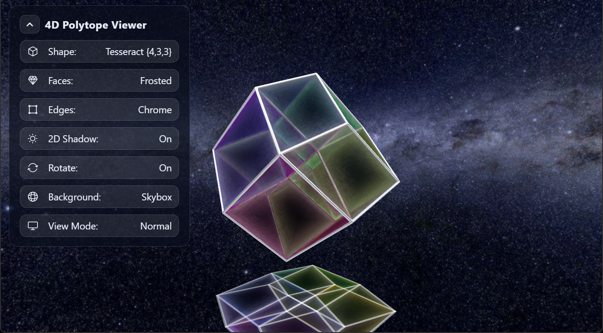

# 4D Polytope Viewer

Rotating 3D and 4D regular polytopes, from the tetrahedron to the 120-cell and 600-cell, viewed on a desktop, in stereo 3D, or in WebXR (VR, passthrough AR, phone viewers).

Live: https://lindblum.github.io/4d-viewer-threejs/



Built with [three.js](https://threejs.org), React, [@react-three/fiber](https://r3f.docs.pmnd.rs), [@react-three/xr](https://pmndrs.github.io/xr/) and Vite.

## Run

```sh
npm install
npm run dev        # http://localhost:5173, with a Quest 3 emulator on localhost
npm run dev:xr     # HTTPS on your LAN, for a real headset or phone
npm run build      # static site in dist/ (relative paths, any host)
```

## Options

| Setting | Choices |
| --- | --- |
| Shape | The 5 Platonic solids and the 6 regular 4D polytopes |
| Background | Solid, Skybox, Passthrough (XR) |
| View Mode | Normal, 3D: SBS (3D TVs), 3D: Interlaced (passive 3D monitors, use fullscreen), XR: HMD Stereo, XR: Phone AR, XR: Phone Viewer |
| Faces | Glow, Glass, Water, Soap, Metal, Frosted |
| Edges | Off, Glow, Glass, Chrome |
| 2D Shadow, Rotate | On / Off |

## Controls

| | Desktop | XR |
| --- | --- | --- |
| Next / previous shape | Click the shape, `Space`, `←` `→` | Trigger or pinch on the shape |
| Orbit / zoom | Drag / scroll | Walk; left stick moves, right stick turns |
| Move, scale, turn the model | — | One grip moves it; both grips scale and turn |
| Move the menu | — | Point at the panel and hold the grip |
| Menu | `Enter` / `Esc` toggles it; `2` shadow, `P` rotate, `1` hide | Look at a button for 1 s to press it hands-free |

## Layout

- `src/polytope.js`, `src/polytopeGeometry.js`: polytope data, 4D rotation and projection
- `src/Scene.jsx`, `src/App.jsx`: the scene, app state, keyboard and windowed menu
- `src/menu.js`, `src/XRMenuPanel.jsx`: the shared options menu and its XR (canvas) panel
- `src/faceLooks.js`, `src/Edges.jsx`: the Faces and Edges looks
- `src/SideBySide.jsx`, `src/Interlaced.jsx`: windowed stereo views
- `src/PhoneStereo.jsx`, `src/Cardboard.jsx`, `src/CardboardLens.js`: phone XR and phone viewers
- `src/Grab.jsx`, `src/grip.js`, `src/Gaze.jsx`: grip controls and gaze dwell-to-click
